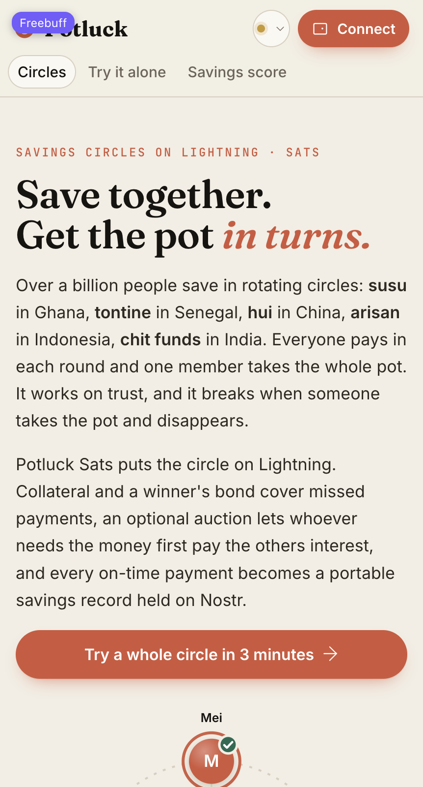
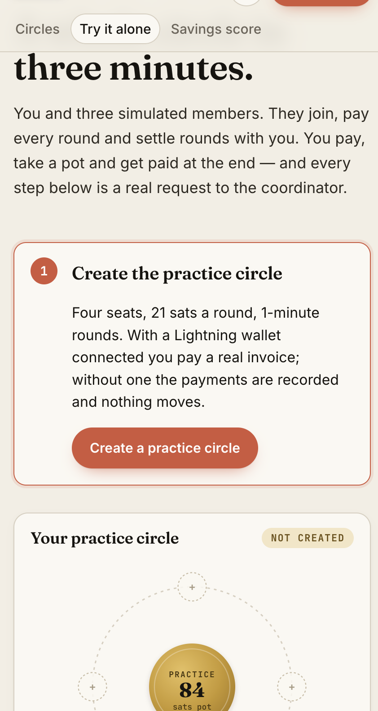
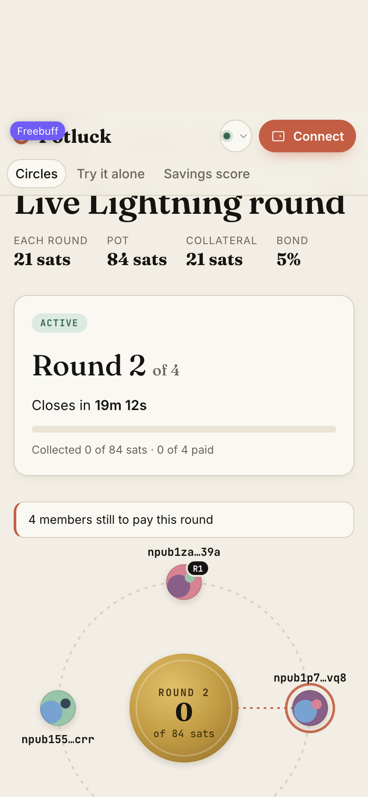
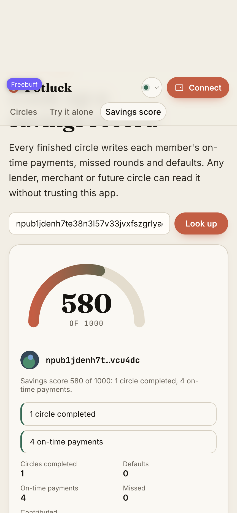

# Zappot

**Community tontines on Bitcoin Lightning.** Save together, settle every pot automatically over NWC, and walk away with a savings record you can carry into the next circle.

Built for the **[Dakar Bitcoin Hack by BTrust 2026](https://dakar-bitcoin-hack-2026.devpost.com/)**.

**Live demo:** <https://zappot.vercel.app> — it opens in practice mode, so the whole circle is playable without a wallet and without co-members.

---

## The problem

Rotating savings circles are how a large part of the world buys a motorbike, stocks a shop, or pays school fees without touching formal credit. The names change — *tontine* in Senegal, *susu* in Ghana, *tanda* in Mexico, *hui* in China, *arisan* in Indonesia, *chit fund* in India — but the mechanism is identical: everyone contributes the same amount each round, and one member takes the whole pot.

It runs on trust, and it fails on trust. Cash changes hands in person, the ledger lives in one person's notebook, reminders are phone calls, and a member who takes an early pot and disappears takes the group's money with them.

Zappot keeps the institution and replaces the two parts that break: **the bookkeeping and the enforcement.**

## What it does

- **Real Lightning settlement.** Contributions are paid to BOLT-11 invoices issued through your own wallet over Nostr Wallet Connect (NIP-47). The pot is paid to the winner's own invoice.
- **Rules instead of trust.** Collateral at join, a winner's bond held back at payout, missed rounds covered from collateral first, defaults excluded from future pots and dividends.
- **Auction mode.** Whoever needs the money first can bid a discount for the pot and pay the rest of the circle for the privilege — interest, without a lender.
- **Nostr identity.** A member is a key, not an account. Every action is a signed event and each circle is published as an addressable note (kind 30078). No email, no phone number, no password.
- **An AI coordinator.** Payment reminders in French, English and Wolof, a plain-language briefing of what needs doing, anomaly flags before money moves, and one-sentence explanations of a savings record. It never touches money, and with no API key every function answers from deterministic templates.
- **A practice circle.** The coordinator runs the other seats, so one person can play an entire circle in about three minutes — no wallet, no co-members.

## Screenshots

| Home | Practice circle |
|---|---|
|  |  |

| Live round | Savings record |
|---|---|
|  |  |

## Quick start

```bash
cd sats
cp .env.example .env
npm install
npm start            # http://localhost:8788
```

Requires **Node 22.6+** (native TypeScript, no build step on the server).

Then point the coordinator at a wallet by putting a Nostr Wallet Connect string in `sats/.env`:

```
NWC_URI=nostr+walletconnect://…?relay=wss%3A%2F%2F…&secret=…
```

Any wallet that supports `make_invoice`, `lookup_invoice` and `pay_invoice` works — Alby Hub, Coinos, Phoenix, LNbits, Mutiny. If you just want to try it, **[faucet.nwc.dev](https://faucet.nwc.dev)** hands out dummy sub-wallets with test sats that exist only inside the faucet:

```bash
curl -X POST 'https://faucet.nwc.dev?balance=10000'
```

Check the wallet answers before demoing — it reads the balance and issues, but does not pay, a 1 sat invoice:

```bash
npm run nwc:smoke
```

`.env` is git-ignored. Never commit a connection string.

## The three-minute demo

1. Open the app and press **Create circle** with **Practice circle** ticked.
2. Press **Fill the open seats** — the simulated members join and the circle starts.
3. Press **Pay 21 sats**. With a wallet connected this is a real BOLT-11 invoice; without one it is recorded as `recorded · no sats moved`.
4. Press **Members pay** so the other seats contribute.
5. Press **Close round 1** at the deadline. The pot is credited to the winning bid.
6. If you took the pot, press **Record payout** (no wallet) or **Get paid** (wallet) — optionally pasting your own invoice.
7. Repeat for the remaining rounds, then take your collateral back and open your savings record.

Every movement lands in the **Transactions** panel with its proof: the payment hash and preimage for real sats, or an explicit note that nothing moved. `Sats in − paid out − owed` is always zero.

## Architecture

```
   member's phone                  coordinator (this process)              Lightning
  ┌───────────────┐               ┌──────────────────────────┐            ┌─────────┐
  │ public/app.js │  signed event │  src/server.ts           │  NIP-47    │  NWC    │
  │ NIP-07 signer │──────────────►│   auth.ts    (verify)    │───────────►│ wallet  │
  │ Guest key     │               │   circle.ts  (rules)     │  encrypted │         │
  └───────┬───────┘               │   store.ts   (atomic JSON│  over relay│         │
          │                       └────────────┬─────────────┘            └─────────┘
          │ kind 30078 note                    │ publish
          └──────────────────► Nostr relays ◄──┘
```

- **Rules** are pure and I/O-free in `circle.ts`: collateral, bond, auction, defaults, pull payments.
- **Sats** move only when the wallet reports an invoice settled, and a payout is refused unless the member's invoice asks for exactly what they are owed.
- **State** is a single JSON file, written atomically under a serialised queue.
- **The model** reads public circle state and writes text. It cannot pay, settle, or change a rule.

Full technical detail — threat model, test inventory, known gaps — lives in **[sats/README.md](sats/README.md)** and **[SECURITY.md](SECURITY.md)**.

## Tests

```bash
cd sats && npm test
```

33 tests, no network and no wallet required, in under a second. Every test that settles a round asserts the money invariant `inSats − paidOutSats − owedSats === 0`.

## Project layout

```
├── sats/            the app: coordinator, rules, tests, web client
│   ├── src/         server, circle rules, auth, NWC, Nostr, AI, BOLT-11
│   ├── public/      single-page client (no build step)
│   ├── test/        33 node:test suites
│   └── browser/     guest signer source, bundled to public/vendor
├── docs/            screenshots
├── SECURITY.md      threat model and limitations
└── LICENSE          MIT
```

## Status and limits

Verified in this build: the full rule set (33 tests), the HTTP flow end to end, the practice path, and the app booting and serving. **Not verified: real Lightning payments** — no live NWC wallet was connected in this environment, so run `npm run nwc:smoke` before a live demo. [SECURITY.md](SECURITY.md) lists the remaining gaps, including payouts that are paid before being recorded and Wolof copy that needs a native review.

## License

MIT © 2026 Vishnuraj. See [LICENSE](LICENSE).
